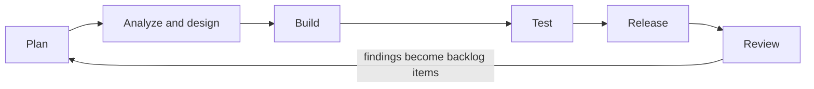
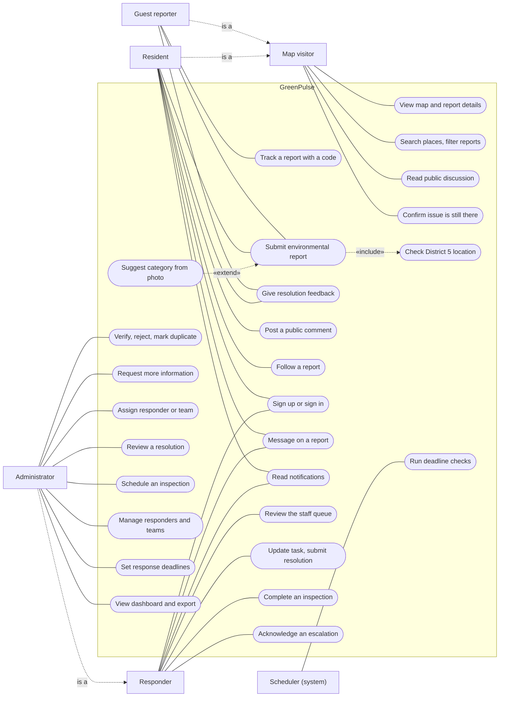
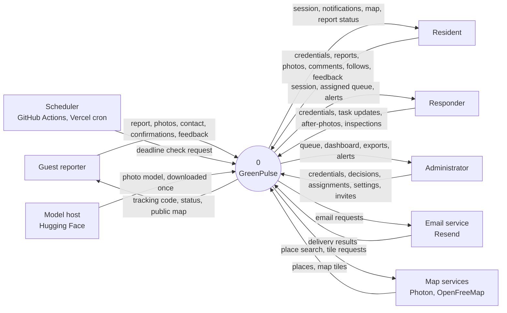
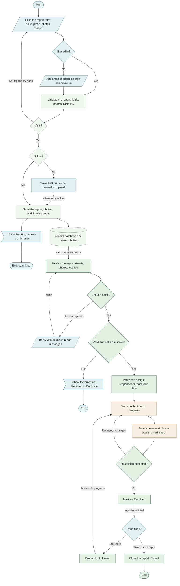
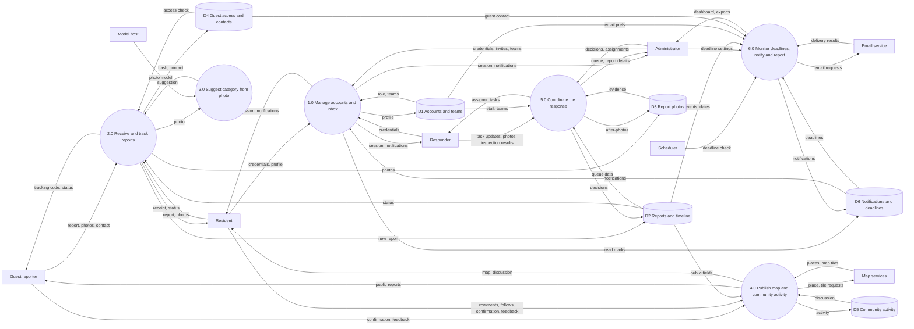
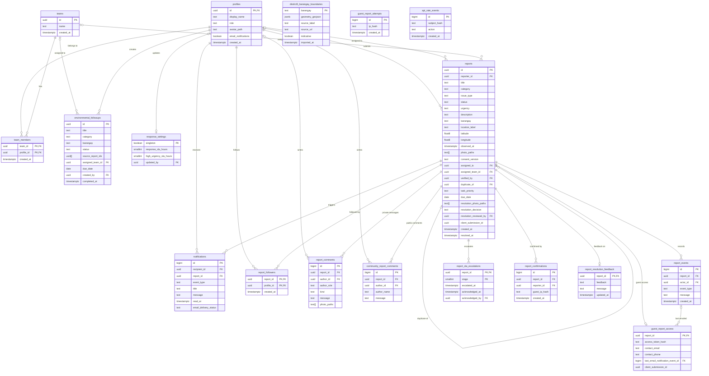

# GreenPulse System Design

**System:** GreenPulse environmental reporting and response coordination for District 5, Quezon City  
**Basis:** Current application source and database migrations in this repository, reviewed 19 November 2026.

## 1. Purpose and scope

GreenPulse lets community members report local environmental issues, lets the public view the community map, and gives city staff a controlled workflow for checking, assigning, and resolving reports. It supports guest reporting with a tracking code and signed-in resident accounts. Responders work on reports assigned to them or their team; administrators manage verification, assignment, teams, inspections, and resolution review.

The deployed product is a React web application that can run as an installable PWA. The repository also contains Capacitor mobile and desktop packaging. In production, Supabase provides authentication, PostgreSQL data, private file storage, row-level security, and realtime updates. Vercel hosts the application and server-side API routes. Without Supabase configuration, the app runs in demo mode with browser-local sample and submitted reports; that data is not shared.

## 2. Development methodology

GreenPulse is built with an iterative, incremental method based on Agile. The work is split into short iterations. Each one takes a slice of the system, such as the staff workflow or guest reporting, through planning, design, building, testing, and release, and ends with a version that can be used and checked. What the review finds goes into the backlog for the next iteration.

The method suits the project because the requirements grew as the system took shape. The District 5 boundary check, the privacy rules for public locations and photos, and guest reporting were all added after the first working versions. Short iterations let each of these land as a small, tested change instead of a late redesign.

| Phase | What it involves in GreenPulse |
| --- | --- |
| Plan | Pick the next slice from the backlog and write what each role must be able to do, for example “an administrator can send a resolution back to the responder.” |
| Analyze and design | Model the change before coding it: the report status flow, the tables and access rules, and the screens. Privacy rules are checked here: rounded public coordinates, private photos, and reporter names hidden until a report is verified. |
| Build | Front end in React 19 and TypeScript. Every database or permission change is a new numbered Supabase migration. Server routes are Vercel edge functions. |
| Test | Unit tests (Vitest) for the business rules in `src/lib`, end-to-end tests (Playwright) that run the app in demo mode, and a strict type check that blocks the build. CI runs the tests and build on every push. |
| Release | Merge through a pull request, deploy to Vercel, and apply new migrations in filename order. |
| Review | Check the release against the pilot measures (response and resolution times, reopened reports by barangay) and record what needs fixing as backlog items. |

Iterations so far, from the commit history and migration files:

| Iteration | Dates (2026) | Focus | Delivered | Release |
| --- | --- | --- | --- | --- |
| 1 | 30 Sep – 7 Oct | Foundation | Database schema and roles, report intake, notifications, location map, admin analytics | v0.2.0 |
| 2 | 8 – 15 Oct | Staff workflow | Staff search and filters, barangays and teams, verification, assignment, resolution review, report messages, response times | v0.34.0 |
| 3 | 16 Oct – 2 Nov | Guest reporting and privacy | Guest reports with tracking codes, resolution feedback, recurring-issue inspections, consent notice, public location privacy, deadline escalations, email delivery tracking, pilot outcomes, District 5 boundary check | v0.35.0, v0.36.0 |
| 4 | 3 – 10 Nov | Community and platforms | Rate limits on public endpoints, public comments, guest phone contact, Windows desktop and Android builds | v0.37.0 |
| 5 | 11 – 13 Nov | Maps and accounts | Engagement counts, MapLibre maps limited to District 5, barangay fit and exact addresses for staff, dark mode, email code at sign-up | PR #2 |
| 6 | 14 – 19 Nov | Polish and privacy | Stat tiles that open report lists, notification fixes, paged report loading, focus kept inside dialogs, report photos limited to staff and the reporter, on-device photo suggestions | PRs #3 – #5 |

Tools: GitHub for version control, pull requests, and CI; Vercel for hosting and server routes; Supabase for the database, sign-in, and file storage; Vitest and Playwright for testing.

## 3. Actors and permissions

| Actor | Main responsibilities |
| --- | --- |
| Map visitor | Anyone who opens the site: view the map and report details, search places, filter reports, read public discussion, and confirm an issue is still there. Guest reporters and residents can do everything a map visitor can. |
| Guest reporter | Browse public reports and discussions, submit a report with an email or phone contact, track it with a private code, confirm an issue, and give resolution feedback. |
| Resident | Create an account, submit and track own reports, follow reports, confirm ongoing issues, comment publicly, communicate privately on own reports, and give resolution feedback. |
| Responder | Review the staff queue and report details, communicate on reports, and start or update only reports assigned directly or through a team. Submit response notes and after-photos for administrator review. Complete assigned inspection tasks. |
| Administrator | Verify, reject, mark duplicate, or request information; correct category and urgency; assign responders and teams; review resolutions; reopen reports; manage staff and teams; schedule inspections; configure response thresholds; and view/export analytics. Administrators can also do everything a responder can. |
| Scheduler | The `Deadline checks` GitHub workflow (every 15 minutes) and the daily Vercel cron call the escalation endpoint, which escalates overdue reports and queues alerts. |
| External providers | Photon supports place search; OpenFreeMap provides vector map tiles built from OpenStreetMap data (OpenStreetMap image tiles are the fallback); Hugging Face hosts the open image model (OpenAI CLIP) that the browser downloads once to read report photos and live camera frames on the reporter's own device and fill in the category; Resend optionally delivers email; Supabase and Vercel provide the backend and hosting services. |

The database enforces access rules with row-level security and workflow triggers. Interface visibility alone is not treated as authorization. Only administrators verify and assign reports or review resolutions. Responders can update only assigned work.

## 4. Use case diagram

Community actors use the public features; staff and the scheduler use the response features. A dotted “is a” arrow means the actor can also do everything the target actor can: guest reporters and residents are map visitors, and administrators can do all responder work. Submitting a report always includes the District 5 check; the photo suggestion extends it only when a photo is added.

The scheduler is the `Deadline checks` GitHub workflow (every 15 minutes) with the daily Vercel cron as a backup.

## 5. Context diagram

GreenPulse is the single process (0). Arrows show the data it exchanges with people and outside services. This is the level 0 view that section 7 breaks down.

**Boundary note:** the web app and PWA, the Vercel API routes, and Supabase (Auth, Postgres, Storage, Realtime) are inside the boundary. Signed-in users normally call Supabase from the client using their authenticated session. Guest submission, guest tracking, responder provisioning, and notification and escalation jobs use server-side API routes. Photo category suggestions run in the browser, so photos are not sent anywhere for them. Server-only secrets stay on the server.

## 6. System flowchart — report lifecycle

The flowchart follows one report from the form to closing. Colors show who does each step: reporter (blue), GreenPulse system (grey), administrator (green), responder (amber).

**Workflow statuses:** `Submitted` → `Under review` → `Verified` → `In progress` → `Awaiting verification` → `Resolved` → `Closed`. A report can also leave review as `Additional information requested`, `Rejected`, or `Duplicate`. Separately from this flow, the scheduled deadline checks escalate reports whose response time has passed and alert the assigned staff.

## 7. Data-flow diagram (DFD) — level 1

Level 0 is the context diagram in section 5. Level 1 opens it into six processes and six data stores. Every flow to or from an outside entity matches a flow in the context diagram.

| No. | Process | What it does |
| --- | --- | --- |
| 1.0 | Manage accounts and inbox | Sign-up with an email code, sign-in, profiles and roles, responder invitations, teams, and each user’s notification inbox. |
| 2.0 | Receive and track reports | Checks and saves reports from guests and residents, stores photos privately, rate-limits guests, issues tracking codes, and answers tracking lookups. |
| 3.0 | Suggest category from photo | Runs an image model in the reporter’s browser and suggests a category, issue type, and title. The photo stays on the device. |
| 4.0 | Publish map and community activity | Serves the public view of reports with rounded coordinates and general place names, plus comments, follows, confirmations, and feedback. |
| 5.0 | Coordinate the response | Staff queue, verification, assignment, task updates, after-photos, and resolution review. Every change is written to the timeline. |
| 6.0 | Monitor deadlines, notify and report | Checks deadlines, escalates overdue reports, creates notifications, sends email, and builds dashboard figures and exports. |

| Store | Holds | Tables |
| --- | --- | --- |
| D1 | Accounts and teams | `profiles`, `teams`, `team_members` |
| D2 | Reports and timeline | `reports`, `report_events`, `report_comments`, `environmental_followups` |
| D3 | Report photos | `report-photos` private storage bucket |
| D4 | Guest access and contacts | `guest_report_access`, `guest_report_attempts`, `api_rate_events` |
| D5 | Community activity | `community_report_comments`, `report_followers`, `report_confirmations`, `report_resolution_feedback` |
| D6 | Notifications and deadlines | `notifications`, `report_sla_escalations`, `response_settings` |

**Privacy flows:** public map data is a restricted projection of report data. Private report photos, guest email and phone, guest tracking hashes, and additional private details are not exposed through the public map. Guest tracking codes are returned to the reporter; only their hashes are stored. Photo storage is private and access is checked for the uploader or authorized staff.

## 8. Entity relationship diagram (ERD)

The database has 18 tables in the `public` schema. `reports` is the centre. `profiles.id` is the same id as Supabase’s `auth.users.id`, so foreign keys to `auth.users` (`reports.reporter_id`, `report_events.actor_id`, `report_confirmations.reporter_id`) are shown against `profiles`. Only key and core columns are listed.

Foreign keys without a relationship line (`verified_by`, `resolution_reviewed_by`, `actor_id`, `acknowledged_by`, and `report_confirmations.reporter_id`) all point to `profiles`. `district5_barangay_boundaries`, `guest_report_attempts`, and `api_rate_events` have no foreign keys.

| Data object | Purpose and important links |
| --- | --- |
| `auth.users`, `profiles` | Sign-in identity and application role (`resident`, `responder`, `admin`). |
| `reports` | Report description, category and issue type, urgency, observation time, coordinates and barangay, consent version, status, assignment, verification, and resolution fields. Guest submissions have no authenticated reporter ID. |
| `report_events` | Append-style history of submission, status, verification, assignment, and resolution changes. |
| `report-photos` storage bucket | Private original and resolution photos; report rows keep storage paths. |
| `guest_report_access` | Guest report token hash, server-only contact email or phone, and tracking metadata. |
| `teams`, `team_members` | Responder groups used for assignment and authorization. |
| `report_comments`, `community_report_comments` | Private report conversation and separate public map discussion. |
| `notifications`, `report_followers`, `report_confirmations`, `report_resolution_feedback` | Recipient-scoped alerts, follows, ongoing-issue confirmations, and reporter outcome feedback. |
| `environmental_followups` | Scheduled inspection tasks linked to recurring report hotspots and assigned teams. |
| `response_settings`, `report_sla_escalations` | Administrator-set overdue thresholds and escalation records; email delivery status sits on `notifications` and `guest_report_access`. |
| `district5_barangay_boundaries` | The 14 barangay outlines the database uses to refuse reports from outside District 5. |
| `guest_report_attempts`, `api_rate_events` | Hashed request records for guest and public endpoint rate limits. |
| `community_reports` (view) | The public projection the map reads: rounded coordinates, generalized place labels, no private fields or rejected reports. |

## 9. Site map

GreenPulse is a single-page app. Its views switch in place instead of loading separate pages, and forms open as dialogs, which become bottom sheets on phones. Labels in parentheses show who can reach a part when that differs from its parent.

```mermaid
flowchart LR
  Root["GreenPulse"]
  Root --> C["Community view (everyone)"]
  Root --> F["Report an issue (everyone)"]
  Root --> S["Staff desk (responder, admin)"]
  Root --> A["Admin dashboard (admin)"]
  Root --> H["Header and account (everyone)"]

  C --> C1["Hero summary: stat tiles open report lists"]
  C --> C2["Incident map: pins, clusters, heatmap, legend"]
  C --> C3["Map search and my location"]
  C --> C4["Report preview: photos for staff and the reporter"]
  C --> C5["Comments and discussion (residents post)"]
  C --> C6["Recent reports list: search, filters, sort"]
  C --> C7["Report card actions: still there, discuss, follow"]
  C --> C8["Your report: Was this issue fixed? (reporter)"]
  C --> C9["Welcome tour"]

  F --> F1["Issue details: title, category, urgency, time"]
  F --> F2["Photos and on-device suggestion"]
  F --> F3["Location picker: District 5 only, barangay autofill"]
  F --> F4["Guest contact: email or phone (guest)"]
  F --> F5["Consent notice"]
  F --> F6["Draft and offline queue"]
  F --> F7["Receipt: tracking code for guests"]

  S --> S1["Deadline escalations"]
  S --> S2["Recurring issues: inspections and follow-ups"]
  S --> S3["Response queue: search and filters, 50 per page"]
  S --> S4["Report detail: workflow panel, exact address"]
  S --> S5["Conversation and timeline"]
  S --> S6["Add a responder (admin)"]
  S --> S7["Manage teams (admin)"]

  A --> A1["Overview: counts and average times"]
  A --> A2["Charts: trends over a date range"]
  A --> A3["Report summary: export PDF, Excel or CSV"]
  A --> A4["Pilot outcomes: response times by barangay"]
  A --> A5["Operations: deadlines, escalations, email delivery, workload"]

  H --> H1["Sign in or create account"]
  H --> H2["Track a report (guest)"]
  H --> H3["Notifications (signed in)"]
  H --> H4["Profile settings (signed in)"]
  H --> H5["Display settings: dark mode, high contrast, reduced motion, compact lists"]
  H --> H6["Command palette: Ctrl or Cmd + K"]
```

## 10. Design constraints and operational notes

- Report submissions require a visibility notice. The public view uses a reduced data projection, generalizes public place labels to a barangay or District 5, and rounds public coordinates. Reporter names can appear only after verification as disclosed in the notice.
- Guest reports require an email or phone, use server-side validation and rate limiting, and return a tracking code. Guest photos are limited to 2.5 MB each; signed-in photos are limited to 5 MB each. Images are compressed in the client before upload.
- Residents can save drafts and queue uploads in IndexedDB. The queue resumes when the app is online; it is a browser-local resilience feature and is not a guaranteed delivery channel.
- Photon place search and map tiles need a network connection. The PWA caches the app shell and static same-origin assets for offline viewing.
- Photo category suggestions run on the reporter's device for guests and signed-in users alike; the photo is never sent anywhere for them. The image model (about 64 MB) is downloaded once from Hugging Face, checked against a pinned SHA-256, and cached; phones on mobile data are asked before the download. The reporter can always change the suggestion or choose by hand.
- Response-time processing and alert emails run through server-side scheduled/manual jobs. In-app notifications do not depend on email delivery.
- Reports outside District 5 are refused in three places: the report form, the guest endpoint, and a database trigger. The trigger enforces only once `district5_barangay_boundaries` has rows; `202611120001_district5_osm_boundaries.sql` loads the bundled barangay outlines for that. The outlines are indicative and should be validated with the participating Quezon City office before a pilot.
