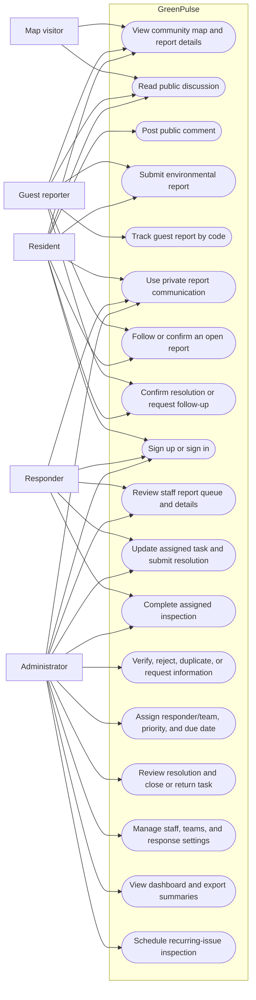
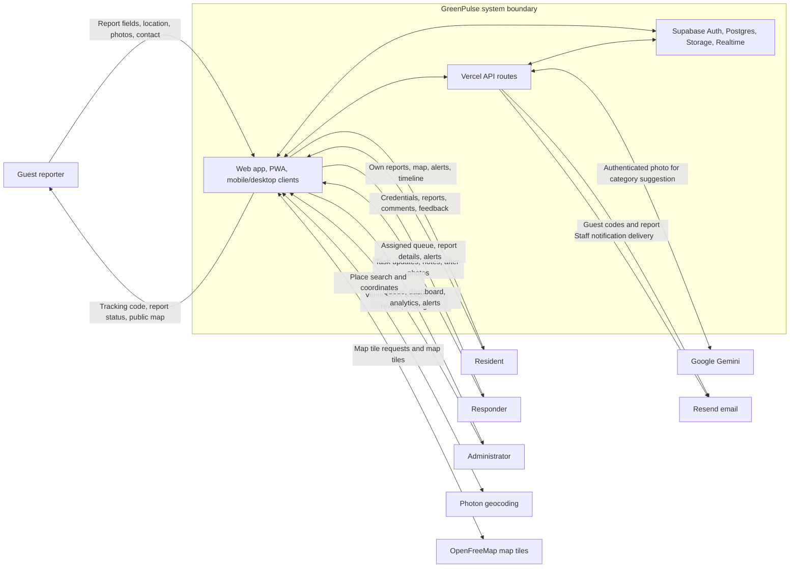
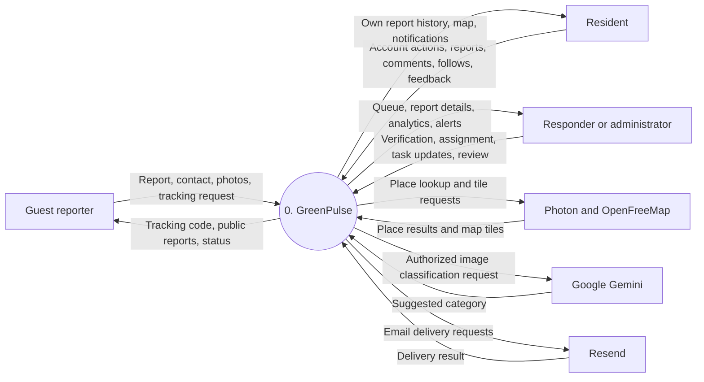
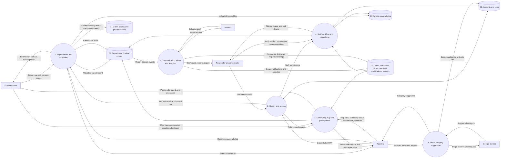
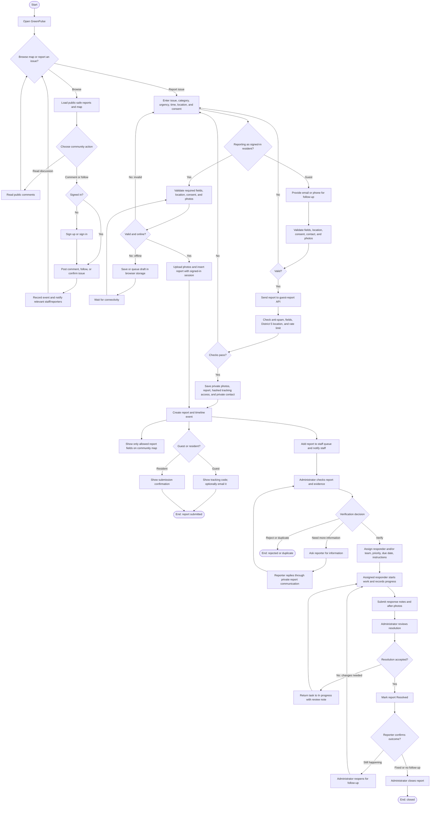

# GreenPulse System Design

**System:** GreenPulse environmental reporting and response coordination for District 5, Quezon City  
**Basis:** Current application source and database migrations in this repository, reviewed 10 November 2026.

## 1. Purpose and scope

GreenPulse lets community members report local environmental issues, lets the public view the community map, and gives city staff a controlled workflow for checking, assigning, and resolving reports. It supports guest reporting with a tracking code and signed-in resident accounts. Responders work on reports assigned to them or their team; administrators manage verification, assignment, teams, inspections, and resolution review.

The deployed product is a React web application that can run as an installable PWA. The repository also contains Capacitor mobile and desktop packaging. In production, Supabase provides authentication, PostgreSQL data, private file storage, row-level security, and realtime updates. Vercel hosts the application and server-side API routes. Without Supabase configuration, the app runs in demo mode with browser-local sample and submitted reports; that data is not shared.

## 2. Actors and permissions

| Actor | Main responsibilities |
| --- | --- |
| Guest reporter | Browse public reports and discussions, submit a report with an email or phone contact, track it with a private code, confirm an issue, and give resolution feedback. |
| Resident | Create an account, submit and track own reports, follow reports, confirm ongoing issues, comment publicly, communicate privately on own reports, and give resolution feedback. |
| Responder | Review the staff queue and report details, communicate on reports, and start or update only reports assigned directly or through a team. Submit response notes and after-photos for administrator review. Complete assigned inspection tasks. |
| Administrator | Verify, reject, mark duplicate, or request information; correct category and urgency; assign responders and teams; review resolutions; reopen reports; manage staff and teams; schedule inspections; configure response thresholds; and view/export analytics. |
| External providers | Photon supports place search; OpenFreeMap provides vector map tiles built from OpenStreetMap data (OpenStreetMap image tiles are the fallback); Google Gemini optionally suggests a report category from a photo; Resend optionally delivers email; Supabase and Vercel provide the backend and hosting services. |

The database enforces access rules with row-level security and workflow triggers. Interface visibility alone is not treated as authorization. Only administrators verify and assign reports or review resolutions. Responders can update only assigned work.

## 3. Use case diagram

## 4. Context diagram

GreenPulse is the system boundary. Arrows show the main information exchanged with people and external services.

**Boundary note:** signed-in users normally call Supabase from the client using their authenticated session. Guest submission, guest tracking, responder provisioning, photo classification, and notification/escalation jobs use server-side API routes. Server-only secrets stay on the server.

## 5. Data-flow diagram (DFD)

### Level 0 — system-level data flows

### Level 1 — major processes and data stores

**Privacy flows:** public map data is a restricted projection of report data. Private report photos, guest email/phone, guest tracking hashes, and additional private details are not exposed through the public map. Guest tracking codes are returned to the reporter; their hashes are stored for access checks. Photo storage is private and access is checked for the uploader or authorized staff.

## 6. System flowchart — report lifecycle

**Workflow statuses:** `Submitted` / `Under review` → `Verified`, `Additional information requested`, `Rejected`, or `Duplicate`; verified reports can be assigned and worked as `Verified` / `In progress`; responders submit `Awaiting verification`; an administrator approves to `Resolved`, returns it to `In progress`, and then closes it as `Closed`. A resident's “still happening” feedback can prompt an administrator to reopen resolved or closed work.

## 7. Core data model

| Data object | Purpose and important links |
| --- | --- |
| `auth.users`, `profiles` | Sign-in identity and application role (`resident`, `responder`, `admin`). |
| `reports` | Report description, category and issue type, urgency, observation time, coordinates/barangay, consent version, status, assignment, verification, and resolution fields. Guest submissions have no authenticated reporter ID. |
| `report_events` | Append-style history of submission, status, verification, assignment, and resolution changes. |
| `report-photos` storage bucket | Private original and resolution photos; report rows keep storage paths. |
| `guest_report_access` | Guest report token hash, server-only contact email/phone, and tracking metadata. |
| `teams`, `team_members` | Responder groups used for assignment and authorization. |
| `report_comments`, `community_report_comments` | Private report conversation and separate public map discussion. |
| `notifications`, `report_followers`, `report_confirmations`, `report_resolution_feedback` | Recipient-scoped alerts, follows, ongoing-issue confirmations, and reporter outcome feedback. |
| `environmental_followups` | Scheduled inspection tasks linked to recurring report hotspots and assigned teams. |
| `response_settings`, escalation/delivery records | Administrator-set overdue thresholds and SLA/email-delivery tracking. |

## 8. Design constraints and operational notes

- Report submissions require a visibility notice. The public view uses a reduced data projection, generalizes public place labels to a barangay or District 5, and rounds public coordinates. Reporter names can appear only after verification as disclosed in the notice.
- Guest reports require an email or phone, use server-side validation and rate limiting, and return a tracking code. Guest photos are limited to 2.5 MB each; signed-in photos are limited to 5 MB each. Images are compressed in the client before upload.
- Residents can save drafts and queue uploads in IndexedDB. The queue resumes when the app is online; it is a browser-local resilience feature and is not a guaranteed delivery channel.
- Photon place search and map tiles need a network connection. The PWA caches the app shell and static same-origin assets for offline viewing.
- Photo category suggestions are optional, require a signed-in session, and send the selected image to Google Gemini through the server API. The user can choose a category manually.
- Response-time processing and alert emails run through server-side scheduled/manual jobs. In-app notifications do not depend on email delivery.
- District boundary geofencing becomes authoritative only after the District 5 barangay boundary data is loaded and validated. Until then the application uses broad coordinate bounds and a barangay list.
